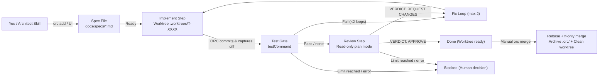

# ORC — Local Mission Control for Coding Agents

[](https://github.com/paradoxsmile/ORC/actions/workflows/ci.yml)
[](LICENSE)
[](https://nodejs.org/)
[](package.json)

**ORC** is a local-first orchestrator that gives you **one task board across all your local Git repositories** and drives the official **Claude Code (`claude`)**, **Google Antigravity (`agy`)**, and optional **OpenAI Codex (`codex`)** CLIs headlessly in isolated Git worktrees.

It owns **artifacts and processes** — specs, worktrees, diffs, review verdicts, test logs, research briefs, token telemetry, and clean local merges — never model APIs or tokens.

> [!IMPORTANT]
> **Please read the [Disclaimers, Rate Limits & Security](#disclaimers-rate-limits--security) section before running automated agent loops against your subscriptions.**

---

## Why ORC?

- **Separate subscriptions, zero API proxying:** `claude`, `agy`, and optional `codex` each keep their own login and quota. ORC spawns the official CLIs headlessly and never stores OAuth tokens or proxies vendor traffic.
- **Focused context per subtask:** Instead of dumping a 100k-token chat history into one session, each task gets a concise spec file (`docs/specs/YYYY-MM-DD-<slug>.md`) and runs in its own isolated Git worktree (`.worktrees/T-0001`).
- **Plan-saving model tiers & compact agent handoffs:** Mark simple/mechanical tasks `--tier low` so implementation uses smaller models (e.g. `sonnet`) while reviewers stay on `high` tier. Internal agent-to-agent prompts and review findings use terse structured notation (`FILE:LINE|SEV|ISSUE|FIX`, smart lockfile `diffIgnore`, and tail-trimmed `test.log`) to cut token waste.
- **Read-only Research Mode (`orc research`):** Offload heavy codebase exploration to `claude` / `agy` / `codex` in read-only `plan` mode (no worktree, no edits), saving full notes to `docs/research/` and returning a ~40-line `brief.md` to your Architect session.
- **Cross-agent verification & per-project queues:** One CLI implements, your test gate runs first, and once green the reviewer checks the diff in read-only `plan` mode (`VERDICT: APPROVE` / `REQUEST CHANGES`, max 2 fix loops). Queue follow-up tasks (`orc queue` / `--depends-on`) to drain automatically when upstream tasks finish.
- **Zero-dependency stack:** Pure Node.js ESM (`>=22.5`, `node:sqlite`), vanilla HTML/CSS/JS dashboard with Server-Sent Events (SSE), no npm packages, no build step.
- **Obsidian-ready memory:** Every registered repo scaffolds `AGENTS.md`, `docs/index.md`, `docs/architecture.md`, `docs/decisions/`, `docs/specs/`, `docs/research/`, and an auto-updated `docs/board.md`.

---

## Architecture & Pipeline



- **One active run per project** (`run.refused` on conflict) and a configurable global cap (`ORC_MAX_CONCURRENCY`, default `2`).
- **Artifacts preserved after merge:** Before `orc merge` deletes `.worktrees/T-XXXX`, ORC archives `spec.md`, `diff.patch`, `review.md`, `test.log`, and prompts into gitignored `<project>/.orc/T-XXXX/` so history stays inspectable in the dashboard.

---

## Quick Start

### 1. Prerequisites
- **Node.js 22.5+** (uses built-in `node:sqlite`)
- **Git** on `PATH`
- **Claude Code (`claude`)** and/or **Google Antigravity (`agy`)** installed and signed in interactively once:
  - Claude Code (PowerShell): `irm https://claude.ai/install.ps1 | iex` (or `winget install Anthropic.ClaudeCode`) → run `claude` once to log in.
  - Antigravity CLI (PowerShell): `irm https://antigravity.google/cli/install.ps1 | iex` → run `agy` once to log in.

### 2. Clone & Install Global Launcher + Skill

```sh
git clone https://github.com/paradoxsmile/ORC.git
cd ORC
node scripts/install-skill.mjs
```

`install-skill.mjs` creates a global `orc` / `orc.cmd` launcher in `~/.local/bin` (so you can run `orc serve`, `orc doctor`, etc. from any folder) and installs the portable `orc-orchestrator` skill for both Antigravity (`~/.gemini/config/skills/`) and Claude Code (`~/.claude/skills/`).

Verify everything is detected:

```sh
orc doctor
node scripts/probe.mjs
```

### 3. Run Your First Task

```sh
# 1. Register an existing Git repository (commit the scaffold once so worktrees inherit AGENTS.md & docs/)
orc project add /path/to/your/repo --name my-app --test "npm test"

# 2. Create a scoped task (starts in Ready because --desc / --accept are provided)
orc add my-app "Retry failed uploads once" \
  --desc "A 5xx response drops the upload permanently. Update src/upload.js only." \
  --accept "- [ ] Retries once on 5xx" \
  --accept "- [ ] Unit test covers the retry" \
  --agent agy

# 3. Start the dashboard OR run directly from the CLI
orc serve          # Dashboard at http://127.0.0.1:4317
orc run T-0001     # Run implement → verify → review loop

# 4. Inspect diff/review in the dashboard, then merge locally when satisfied
orc merge T-0001
```

> **Windows PowerShell note:** If PowerShell blocks `npm.ps1`, run Node scripts directly (`node scripts/check.mjs`, `node --test`, `node scripts/smoke.mjs`, or `orc ...` after running `install-skill.mjs`).

---

## Dashboard Features

Open **`http://127.0.0.1:4317`** after running `orc serve`:

- **Multi-project Kanban board:** Lanes for `Inbox`, `Ready` (includes `Queued`), `Working` (implementing/fixing), `Review` (reviewing/verifying), `Blocked`, and `Done`, updated live over SSE with task kind (`research`), model tier (`low`/`high`), dependency tags, and token totals on cards.
- **Task Drawer:**
  - **Spec tab:** Edit Markdown directly with `Preview` / `Edit` toggle and `Save spec` (moves `Inbox` tasks to `Ready`).
  - **Brief tab (Research tasks):** Rendered Markdown executive brief (`Rendered` / `Raw` toggle).
  - **Review tab:** Rendered Markdown with highlighted green/red `VERDICT` badges (`Rendered` / `Raw` toggle).
  - **Diff tab:** Colorized unified diff with file count and `+/-` stats (`Colorized` / `Raw` toggle), with lockfiles/minified assets summarized via `diff --stat`.
  - **Tests & Events tabs:** Full `test.log`, per-run model/token/cost telemetry, tool activity, and amber **Quota Notice** banners when `agent.rate_limit` or `run.paused_quota` events fire.
  - **Actions:** `Run`, `Queue`, `Stop`, `Merge` (code tasks), `Open folder`, `Spec file`, `Mark done`, `Block`, `Delete`, and manual state dropdown.
- **Project Settings (⚙ Settings):** Edit `baseBranch`, `testCommand`, `setupCommand`, `diffIgnore`, `reviewer` policy (`default`, `auto`, `same`, `claude`, `agy`, `codex`), `implModel`, and `reviewModel` live without restarting `orc serve`, or unregister the project.
- **CLI Health Modal:** Click the `Claude · Antigravity · Codex · Git` indicators in the top bar to view binary paths and setup commands.

---

## CLI Reference

| Command | Purpose |
| :--- | :--- |
| `orc serve [--port 4317]` | Start the local dashboard and REST/SSE API on `127.0.0.1` |
| `orc doctor` | Check Node, Git, `claude`, `agy`, optional `codex`, registered repos, and stale worktrees |
| `orc project add <path> [flags]` | Register & scaffold a repo (`--name`, `--base`, `--test`, `--setup`, `--diff-ignore`, `--reviewer`, `--impl-model`, `--review-model`) |
| `orc project list` | List registered projects and task counts |
| `orc project remove <id\|name>` | Unregister a project from `orc.config.json` (leaves files on disk untouched) |
| `orc init <project\|path>` | Write `AGENTS.md`, `docs/`, and `.gitignore` scaffold only |
| `orc add <project> "<title>" [flags]` | Create task (`T-XXXX`), spec file, and branch (`--desc`, `--accept`, `--agent claude\|agy\|codex`, `--tier low\|med\|high`, `--depends-on T-0001`, `--type code\|research`) |
| `orc research <project> "<q>" [flags]` | Create (and with `--run`, execute) a read-only research task (`--agents claude,agy`, `--tier low\|med\|high`) |
| `orc list [project]` | List tasks with state, tier, agent, and title |
| `orc run <taskId>` | Run the implement → verify → review pipeline (or read-only research) |
| `orc queue <taskId>` | Queue a task behind active project work or `--depends-on` dependencies |
| `orc stop <taskId>` | Stop the active run (works across terminals via SQLite PID) |
| `orc merge <taskId>` | Rebase task branch onto `baseBranch`, fast-forward, archive `.orc/`, remove worktree & branch, mark `done` |
| `orc delete <taskId> [--clean]` | Delete task from board (`--clean` also removes its worktree & `.orc/` artifacts) |
| `orc state <taskId> <state>` | Manually move a task (`inbox\|specced\|queued\|working\|review\|fixing\|verify\|done\|blocked`) |
| `orc done <taskId>` / `orc block <taskId>` | Mark done or blocked with `--note "..."` |
| `orc status` | Regenerate `STATUS.md` and `docs/board.md` and print board, queue, token usage, and quota summary |
| `orc open [task\|project]` | Open worktree, `--spec`, or `--project` in the OS file explorer |
| `orc install` | Install global `orc` / `orc.cmd` launcher and `orc-orchestrator` skill |

---

## Configuration & Environment Variables

`orc.config.json` is gitignored so your local project registry stays private (see [orc.config.example.json](orc.config.example.json)). Runtime SQLite data (`data/orc.db`), run logs (`data/logs/`), probe traces (`data/probes/`), and `STATUS.md` are also gitignored.

| Variable | Default | Purpose |
| :--- | :--- | :--- |
| `ORC_CONFIG` | `./orc.config.json` | Override path to config file |
| `ORC_DATA_DIR` | `./data` | Override SQLite & logs directory |
| `ORC_MAX_CONCURRENCY` | `2` | Global limit of concurrent runs across different projects |
| `ORC_MAX_FILE_BYTES` | `5242880` (5 MiB) | Block staging/committing oversized files or binaries in `captureWork` |
| `ORC_PAUSE_ON_UTILIZATION` | unset (off) | Pause new/queued runs for a vendor when rate-limit utilization reaches threshold (e.g., `0.90` or `90`) |
| `ORC_COMPACT_HANDOFF` | `1` (on) | Use terse machine-dense agent-to-agent prompts and review schemas (`0` for verbose prose) |
| `ORC_REVIEWER` | opposite CLI | `claude`, `agy`, `codex`, `same`, or `auto` (falls back if other CLIs missing) |
| `ORC_CLAUDE_<LOW\|MED\|HIGH>_MODEL` | `low=sonnet` | Per-tier Claude model routing (reviewer defaults to `high` tier; `ORC_CLAUDE_IMPL_MODEL` / `ORC_CLAUDE_REVIEW_MODEL` / `ORC_CLAUDE_MODEL` also supported) |
| `ORC_AGY_<LOW\|MED\|HIGH>_MODEL` | CLI default | Per-tier Antigravity model routing (`ORC_AGY_IMPL_MODEL` / `ORC_AGY_REVIEW_MODEL` / `ORC_AGY_MODEL` also supported) |
| `ORC_CODEX_<LOW\|MED\|HIGH>_MODEL` | CLI default | Per-tier Codex model routing (`ORC_CODEX_IMPL_MODEL` / `ORC_CODEX_REVIEW_MODEL` / `ORC_CODEX_MODEL` also supported) |
| `ORC_AGY_EFFORT` | unset | Reasoning effort (`low\|medium\|high\|xhigh\|max`; `ORC_AGY_<TIER>_EFFORT` supported; omitted for Orchestrator slugs) |
| `ORC_AGY_YOLO` | unset (off) | Set to `1` to pass `--dangerously-skip-permissions` to Antigravity implementation runs |
| `ORC_CODEX_YOLO` | unset (off) | Set to `1` to pass `--dangerously-bypass-approvals-and-sandbox` instead of `--full-auto` to Codex impl runs |

Per-project settings configured in **⚙ Settings** (`implModel`, `reviewModel`, `reviewer`, `diffIgnore`, `setupCommand`, `testCommand`, `baseBranch`) and global `tiers` in `orc.config.json` let you tune cost and reasoning cleanly without restarting ORC.

---

## Best Practices & Obsidian Integration

See **[docs/best-practices.md](docs/best-practices.md)** for full workflows on:
- **Large repositories (e.g., Formula Student, embedded, monorepos):** writing a crisp 1-page `AGENTS.md`, excluding heavy build/telemetry folders, and using `setupCommand` for submodules/venvs.
- **Architect + Worker pattern:** using [skills/orc-orchestrator/SKILL.md](skills/orc-orchestrator/SKILL.md) inside an interactive Antigravity or Claude Code chat to decompose features into tightly scoped ORC subtasks.
- **Obsidian brain memory:** opening `<project>/docs/` as an Obsidian vault so `index.md`, `architecture.md`, `decisions/ADR-*.md`, `specs/`, and `board.md` stay synchronized across you and your agents.

---

## Testing & Verification

```sh
node scripts/check.mjs   # Syntax check all JS, validate JSON, verify required files & privacy
node --test              # Offline unit tests (verdict, flags, state machine, git capture, merge, concurrency, parsers)
node scripts/probe.mjs   # Probe installed claude / agy CLIs and save JSONL traces to data/probes/
node scripts/smoke.mjs   # End-to-end test using fake CLIs, real Git worktrees, merge, and HTTP/SSE API
```

---

## Disclaimers, Rate Limits & Security

> [!WARNING]
> **Read carefully before running unattended agent loops:**

1. **No Affiliation:** ORC is an independent open-source project and is not affiliated with, endorsed by, or sponsored by Anthropic or Google.
2. **Terms of Service & Authentication:** ORC executes the official `claude` and `agy` binaries in headless mode. It **never** calls vendor REST APIs directly, **never** stores or proxies OAuth credentials, and **never** pools or shares accounts. You are solely responsible for complying with Anthropic's and Google's terms of service and acceptable use policies.
3. **Subscription Quotas & Rate Limits:** Each task executes at least one implementation run and one review run, and up to two fix-and-re-review cycles (up to 6 CLI invocations per task). Repeated runs on large codebases can rapidly consume 5-hour or 7-day subscription limits or API credits. Monitor the dashboard (`agent.rate_limit` warnings), write tight specs, use `Stop` whenever a run goes off-track, and check your vendor usage dashboards regularly.
4. **Headless Permissions & Shell Risk:**
   - Git worktrees isolate **tracked workspace files**, **not** your operating system, network, or shell environment.
   - Claude Code runs with `--permission-mode acceptEdits` (`Read,Edit,Write,Bash`) during implementation and `--permission-mode plan` (`Read,Grep,Glob,Bash`) during review.
   - Antigravity defaults to `--mode accept-edits` **without** `--dangerously-skip-permissions`. Prefer scoped `permissions.allow` rules in `~/.gemini/antigravity-cli/settings.json`; only enable `ORC_AGY_YOLO=1` in repositories and environments you fully trust.
5. **Localhost-Only Server (`127.0.0.1`):** The HTTP server binds strictly to `127.0.0.1` with **no authentication**. Never forward or expose the port to a network. See [SECURITY.md](SECURITY.md) for the full threat model.
6. **No Warranty:** Provided "AS IS" under the [MIT License](LICENSE). Always review `diff.patch`, `review.md`, and `test.log` before running `orc merge` — ORC intentionally never pushes or creates PRs automatically.

---

## Troubleshooting & Contributing

- Stuck on setup, permissions, or Git worktrees? Read **[docs/troubleshooting.md](docs/troubleshooting.md)**.
- Want to contribute? Read **[CONTRIBUTING.md](CONTRIBUTING.md)** and **[AGENTS.md](AGENTS.md)**.
- Release history: **[CHANGELOG.md](CHANGELOG.md)**.
